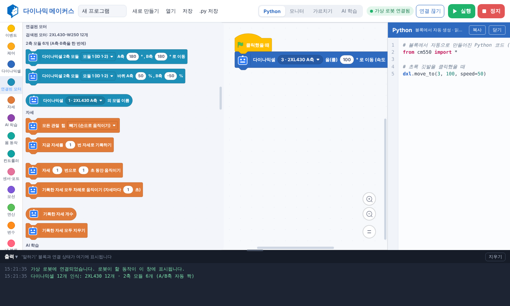

# 다이나믹 메이커스 (Dynamic Makers)

RoboMakers의 ROBOTIS **CM-550 + DYNAMIXEL**용 워드블럭(블록 코딩) 앱입니다. 초·중등 교육용으로 만들었습니다.
블록 화면 옆에서 같은 프로그램의 Python 코드를 실시간으로 보여 줍니다(Pybricks Code 방식).

**▶ 웹에서 바로 실행:** https://daewonlee81-glitch.github.io/Dynamic-Makers/
(Chrome 또는 Edge에서 열어 주세요. USB·블루투스 연결은 이 두 브라우저에서만 됩니다.)



## 폴더 구성

| 폴더 | 내용 |
|---|---|
| [`dynamicmakers/`](dynamicmakers/) | 앱 본체(화면, 블록 분류, 모니터, 진단, 가상 로봇, 실행기, 빌드 스크립트) |
| [`docs/`](docs/) | GitHub Pages로 서비스되는 웹 앱(빌드 결과물) |
| [`scratch-cm550/`](scratch-cm550/) | 공용 코드: DYNAMIXEL Protocol 2.0, USB(Web Serial)·BLE 통신, CM-550 블록, 모델 자동 인식, 블록→Python 변환기. Scratch 3 / TurboWarp 확장으로도 사용 가능 |

## 주요 기능

- USB(Web Serial)와 블루투스(Web Bluetooth)로 연결, 가상 로봇으로 하드웨어 없이 시험
- CM-550 별도 펌웨어 불필요(기본 펌웨어의 Manage 모드로 다이나믹셀 패킷 중계)
- 다이나믹셀 모델 자동 인식: XL430, 2XL430(A/B축 자동 짝), XL330, XC430/2XC430, XC330, XH430, XM430
- 모니터(ID·모델·각도·온도·전압·토크), 연결 문제 [진단]
- **자세 가르치기:** 관절 힘을 빼고 손으로 자세를 만들어 기록 → 재생·블록으로 만들기 (MAX-E1 휴머노이드 등)
- **몸 동작(스켈레톤):** PC 카메라로 사람의 관절을 찾아 팔 각도를 로봇 모터가 따라 하게 하거나, 몸 자세를 학습
- **AI 학습:** 카메라·소리·로봇 센서로 종류별 예시를 모아 브라우저 안에서 학습(인터넷 불필요) → "AI가 [종류]를 알아봤을 때" 블록
- 저장 형식 `.dmk`(Scratch 3 project.json), `.py` 내보내기

## 빌드

```bash
cd scratch-cm550 && npm install && cd ..
cd dynamicmakers && npm install
./build.sh            # MODE=web: 웹 배포용 (dist/)
MODE=file ./build.sh  # PC 실행본: 단일 HTML (dist-file/)
```

웹 서비스(`docs/`) 갱신: `./build.sh` 후 `./scripts/make-pages.sh <scratch-blocks/media 경로>`를 실행하고 커밋합니다.
GitHub 설정: Settings → Pages → Source **Deploy from a branch**, Branch **main**, 폴더 **/docs**.

자세한 내용은 [`dynamicmakers/README.md`](dynamicmakers/README.md)와 [`scratch-cm550/docs/python-api.md`](scratch-cm550/docs/python-api.md)를 참고하세요.

## 라이선스 안내

- 블록 그래픽: scratch-blocks (Apache-2.0)
- AI: TensorFlow.js, MobileNet v1 가중치, MoveNet (Apache-2.0)
- 실행 엔진: @scratch/scratch-vm 15.x (**AGPL-3.0**) — 이 엔진을 포함해 배포하면 AGPL 조건이 적용됩니다.
- 이 저장소 코드의 라이선스는 아직 정하지 않았습니다.
